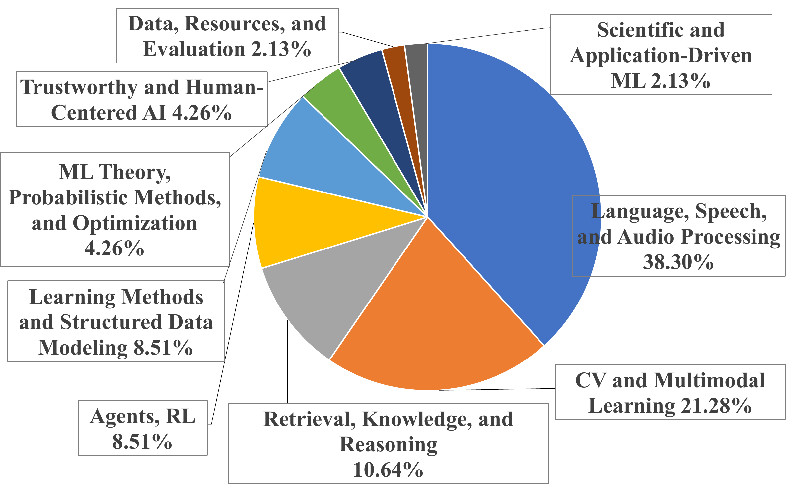

<div align="center">

# ReproBoundary

**An Agent Capability Boundary Benchmark for Complex Paper-to-Code Reproduction**

[Task list](task_pool/TASK_INVENTORY_47.csv) ·
[Trajectory dataset](https://huggingface.co/datasets/SupingSun/ReproBoundary-Execution-Trajectories) ·
[Website](website/) ·
[Data description](docs/DATA_CARD.md) ·
[Evaluator guide](docs/EVALUATOR_PROVENANCE.md) ·
[Migration guide](docs/PORTABILITY.md)

</div>

<div align="center">
  
</div>

ReproBoundary tests whether a coding agent can reproduce one specified
experiment from a research paper. Each task fixes the data, required stages,
resource limits, result to report, and program used to check that result.

> **Scope.** A task reproduces one selected result under a fixed resource
> limit. It does not reproduce every result or support every conclusion in the
> source paper.

## At a glance

| Released material | Count | What it provides |
| --- | ---: | --- |
| Paper-reproduction tasks | 47 | One fixed experiment from each paper |
| Model-agent settings | 9 | Nine combinations of a language model and coding agent |
| Execution logs | 423 | Cleaned, compressed logs hosted in the separate Hugging Face dataset |
| Evaluator records | 47 | The exact metric, command, source, and version for each task |

Twenty tasks keep the experiment size selected from the paper. The other 27
reduce training, search, or repeated work to fit the benchmark resource limit.
All 47 tasks retain their complete target evaluation set.

## Start here

- **Browse the papers and tasks:**
  [`TASK_INVENTORY_47.csv`](task_pool/TASK_INVENTORY_47.csv) is the readable
  table; [`tasks.jsonl`](task_pool/tasks.jsonl) contains the same task records
  in a machine-readable format.
- **Study an agent run:**
  [`TRAJECTORY_INDEX.csv`](trajectories/TRAJECTORY_INDEX.csv) links every task
  and model-agent setting to its `agent.log.gz` file in the
  [trajectory dataset](https://huggingface.co/datasets/SupingSun/ReproBoundary-Execution-Trajectories).
- **Check a submitted result:**
  [`EVALUATOR_INDEX.csv`](evaluators/EVALUATOR_INDEX.csv) identifies the
  evaluation command, source-code version, and required helper files.
- **Move an evaluator to another machine:** follow the
  [migration guide](docs/PORTABILITY.md) without changing the task's data,
  method, or metric.

## Download and verify the code release

```bash
git clone https://github.com/endlesssalaxy/ReproBoundary.git
cd ReproBoundary
python3 scripts/verify_release.py
```

Expected output:

```text
verification OK: tasks=47 evaluators=47 trajectory_records=423 bundled_logs=0
```

This check confirms file hashes, index entries, task and evaluator counts,
evaluator size limits, and that no compressed trajectory logs are bundled in
the GitHub repository.

## Download and verify the trajectories

The 423 compressed logs are stored in the public
[Hugging Face dataset](https://huggingface.co/datasets/SupingSun/ReproBoundary-Execution-Trajectories)
at revision `57e17e11f795c6df9f7806ad2262fd32897ec2e6`. No account or access
token is required to download the public dataset.

```bash
python3 -m venv .hf-venv
source .hf-venv/bin/activate
python -m pip install "huggingface_hub>=1.0,<2"

hf download SupingSun/ReproBoundary-Execution-Trajectories \
  --repo-type dataset \
  --revision 57e17e11f795c6df9f7806ad2262fd32897ec2e6 \
  --local-dir ReproBoundary-Execution-Trajectories

cd ReproBoundary-Execution-Trajectories
python3 scripts/verify_dataset.py
```

Expected output:

```text
verification OK: tasks=47 settings=9 trajectories=423
```

The dataset check reads every gzip file and verifies all 423 indexed SHA-256
hashes. SHA-256 is a file fingerprint used to detect changed bytes. The
download is about 399 MB; allow at least 1 GB of free space. A full check took
about two minutes on the machine used for the release audit.

To inspect one log without extra Python packages, run the example in the
[trajectory guide](trajectories/README.md). It prints the run metadata, checks
the selected file hash, and shows only the first 20 lines.

## Repository map

| Path | Contents |
| --- | --- |
| [`task_pool/`](task_pool/) | Paper list, selected experiments, reported reference values, datasets, budgets, and pinned source-code versions |
| [`trajectories/`](trajectories/) | The small index connecting each externally hosted log to its task and model-agent setting |
| [`evaluators/`](evaluators/) | Per-task evaluation instructions and small helper files used to calculate the target metric |
| [`protocol/`](protocol/) | Prompt and task-file templates given to the agents |
| [`docs/`](docs/) | Data scope, file sources, licenses, cleaning rules, release checks, and evaluator migration instructions |
| [`website/`](website/) | Benchmark homepage and an unpublished leaderboard placeholder |

## Task definitions

Each row in [`TASK_INVENTORY_47.csv`](task_pool/TASK_INVENTORY_47.csv) records:

- the paper title and research area;
- the selected experiment and result to report;
- the value reported by the paper;
- paper-scale and benchmark-scale work;
- dataset and final evaluation data;
- time, hardware, memory, and storage limits; and
- source repository and exact code version.

The reduced tasks change only the amount of training, search, or repeated work
allowed by their fixed specification. They still test one selected result on
the complete target evaluation set.

## Execution logs

Every planned run has one cleaned `agent.log.gz` file in the separate
[trajectory dataset](https://huggingface.co/datasets/SupingSun/ReproBoundary-Execution-Trajectories).
GitHub keeps only the central index. Credentials, private paths, authorization
headers, cookies, and similar sensitive text have been removed or replaced.

The archive contains 418 completed run records, four logs whose final state is
unresolved, and one snapshot saved while a run was active. These states are
preserved as recorded rather than converted into guessed outcomes.

## Evaluators

Every task has a `TARGET_EVALUATION.json` file describing the required outputs,
program to run, metric to calculate, and result format. The evaluator index
also fixes the source URL and exact code version.

Some helper files come from the source-paper repositories. Others were written
for ReproBoundary to prepare inputs, check completeness, or combine repeated
runs. [Evaluator file origins](docs/EVALUATOR_PROVENANCE.md) identifies which
is which.

Recomputing a metric can confirm a submitted number. It does not by itself
prove that the agent completed every required experimental stage. Stage checks
and metric checks must therefore remain separate.

The trajectory dataset contains logs, not saved predictions, checkpoints,
model weights, or training states. The logs support chronology, tool-use,
failure, and release-integrity analysis. They are not sufficient by themselves
to recompute most task metrics.

## Preview the website

```bash
python3 scripts/build_site_data.py
python3 -m http.server 8765 --directory website
```

Open `http://127.0.0.1:8765` in a browser. The repository does not currently
publish leaderboard results; the page contains a placeholder only.

## Not included

The GitHub release does not contain trajectory logs, datasets, trained model
files, saved training states, saved predictions, complete copies of third-party
projects, credentials, or private machine records. Download the trajectories
from the fixed Hugging Face dataset and public dependencies from the exact
links and versions recorded in the task and evaluator files.

## Contributing

See [CONTRIBUTING.md](CONTRIBUTING.md). A change to a task, evaluator, or result
must include a public source or saved evidence and the exact file or code
version supporting the change.

## License

No top-level license has yet been selected for files written by the
ReproBoundary team. Public access does not by itself grant permission to copy,
modify, or redistribute those files. Papers, datasets, models, source
repositories, and original evaluation programs retain their own licenses. See
[`docs/LICENSES.md`](docs/LICENSES.md) before reuse.
